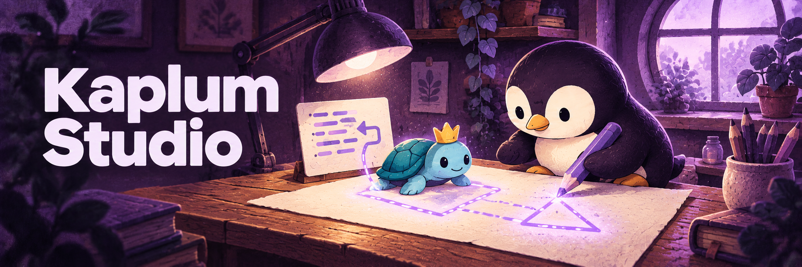

*AI-generated banner illustration; [asset sources and scope](docs/images/README.md).*

# Kaplum Studio

### Change a number. See an idea take shape.

[**Open Studio →**](https://pengusto.github.io/kaplum-studio/) · [Command reference](https://pengusto.github.io/kaplum-studio/docs/) · **English** · [Deutsch](docs/readme/README.de.md)

[](#license)
[](https://github.com/pengusto/kaplum-studio/actions/workflows/pages.yml)
[](#project-status)

Kaplum Studio is a visual JavaScript Turtle playground for programming beginners and the people teaching them. Pick a drawing, see the code beside its result, and change a parameter to discover what it does.

It grew out of beginner programming courses: the difficult part was often connecting `drawDino(80, "LimeGreen", 25)` to *which number changes what*. Kaplum puts that connection on screen.


## Your first experiment

No installation or account needed: [open the dinosaur](https://pengusto.github.io/kaplum-studio/#figure/figur-dino).

1. Run the example and open its parameter explanations.
2. Change the size or colour, then run it again. The drawing comes from the code you see.
3. Try [Square replay](https://pengusto.github.io/kaplum-studio/#course/square) to walk through a drawing, or [Own functions, step by step](https://pengusto.github.io/kaplum-studio/#course/functions) to inspect code execution.
4. Export a ZIP, unzip it and open `index.html`. Your exact `program.js` and the engine travel with it; no server or internet connection is needed.

## From a picture to a program

| Explore | Understand | Make it yours |
| --- | --- | --- |
| 32 figures, 77 commands and helpers, 26 animations | Numbered arguments, parameter meanings and editable catalogue controls | CodeMirror editor beside the canvas on desktop; panel tabs on mobile |
| Nine guided course experiments with a goal and an edit challenge | Recorded drawing playback, drawing undo and live Turtle position/direction | Keyboard and pointer input, stamps, circles and general drawing helpers |
| Searchable examples with real engine previews | A bounded source debugger with line breakpoints, primitive variables and named function stepping | Exact-source offline ZIP export |

Figure and command cards update their drawing and displayed call as you adjust numbers, colours or booleans. Expression arguments stay read-only; existing Studio drafts are preserved. Previews run only while visible, explicit pauses survive catalogue navigation, and reduced motion requires explicit playback.

Learner code runs in a Web Worker inside a sandboxed iframe. Stop, navigation and hidden tabs terminate execution; the suite checks that an infinite loop does not freeze the interface.

Appearance and canvas background can be changed independently, with ten Studio colour presets saved locally. The app is a static site: no backend, account, analytics or cloud storage.

## Drawing steps and code steps

**Drawing playback** records finite synchronous programs. Previous/next steps show drawing states; drawing undo discards later drawing history. Neither rewinds JavaScript variables. Frame animations have separate pause/resume controls; timer and input programs use Run/Stop.

**Debug code** pauses before supported source instructions. Use Next code statement or Continue, inspect primitive variables and active calls, and set a line breakpoint. Named learner functions with plain parameters and returns are supported. The prototype handles a bounded subset of JavaScript; see [supported syntax and limitations](docs/source-debugger.md).


These are actual Studio screenshots, captured by the production screenshot test in [`tests/studio.spec.js`](tests/studio.spec.js), not mockups or AI-generated illustrations. They show example content; third-party component licences still apply (see [License](#license)).

## Run locally

Requires [Bun](https://bun.sh) **1.4.2**, Git and a current Chromium or Firefox. Safari remains untested.

```sh
git clone https://github.com/pengusto/kaplum-studio.git
cd kaplum-studio
bun install --frozen-lockfile
bun run dev
```

Open [localhost:4173](http://localhost:4173). If that port is already in use, leave the other server running and use `bun run dev --port 4193`, then open `http://localhost:4193`. For a production build:

```sh
bun run build      # static export in out/
bun run preview    # serves out/ at http://localhost:4173
```

`out/` can be served by a static web server. GitHub Pages needs the `/kaplum-studio` base path:

```sh
NEXT_PUBLIC_BASE_PATH=/kaplum-studio bun run build
NEXT_PUBLIC_BASE_PATH=/kaplum-studio bunx playwright test tests/pages.spec.js tests/structured-data.spec.js
```

Install the test browsers first as described below.

## Project status

**Early development; classroom acceptance is still open.** The [status record](docs/project-status.md) documents a development pause after the Home, beginner-audience and structured-data updates. The example library, editable parameters, course, themes and offline exports are implemented; a working feature is not evidence that beginners understand it unaided.

Remaining work includes the [short German classroom trial](docs/classroom-trial.de.md), Safari/slower-device checks and native-speaker translation review. Broader debugger support ([#6](https://github.com/pengusto/kaplum-studio/issues/6)) and independent named turtles ([#7](https://github.com/pengusto/kaplum-studio/issues/7)) remain open; optional p5.js mode is deferred.

**Languages:** interface and teaching content cover English, German, Japanese, Turkish and Armenian. Translations are AI-assisted and await native-speaker review. Learner code keeps English JavaScript names; German teaching-command aliases are available. Changing the interface language does not translate an edited program.

## Build, test and contribute

Built with Next.js static export, React 19, CodeMirror 6 and a maintained Canvas Turtle engine. Selected UI components come from React Bits and Lucide.

The Playwright suite checks catalogue/search, animation controls, loop isolation, settings, keyboard access, mobile layouts, source-preserving edits and an extracted offline ZIP that actually runs.

```sh
bunx playwright install chromium firefox
bun run build
bun run test
PLAYWRIGHT_BROWSER=firefox bun run test
```

Direct test runs refresh screenshots in `docs/images/`; set `KAPLUM_SCREENSHOT_DIR` to a temporary directory to keep them out of your diff. See [Contributing](CONTRIBUTING.md) for focused changes, translation rules and classroom-data boundaries.

For maintainers, install the versioned hook once per clone with `bun run hooks:install`. Before every push, `bun run verify:push` checks the production build, full Chromium and Firefox suites, and the Pages subpath build/tests. The pre-push hook enforces those checks and keeps screenshots temporary. After committing on `main`, use `bun run push:verified`; it pushes through the hook and waits for the Pages workflow for that exact commit. Pull requests run CI; Pages deployment requires successful build and verification.

| Read next | Purpose |
| --- | --- |
| [Teaching API](docs/teaching-api.md) | Commands, coordinates, input, stamps and export contracts |
| [Architecture](docs/architecture.md) | Execution model and project layout |
| [Source debugger](docs/source-debugger.md) | Supported syntax, stepping and limits |
| [Project status](docs/project-status.md) | Dated verification evidence and remaining work |

## License

Kaplum Studio's own code is released under the [MIT License](LICENSE). This does not replace third-party terms:

- `engine/library.js` is a new Canvas Turtle core under MIT, replacing the earlier adapted teaching-fork engine and RGB parser. The drawing helpers in `engine/functions.js` were created by Enis Uysal with Codex assistance, according to the owner's declaration. This public repository starts from the current source snapshot and excludes the earlier teaching-fork history. See [engine provenance](docs/engine-migration.md).
- Vendored [React Bits components](components/react-bits/README.md) retain **MIT + Commons Clause** under [their licence](components/react-bits/LICENSE.md); they are not included in learner ZIPs.
- Dependency attributions remain in [THIRD_PARTY_NOTICES.txt](THIRD_PARTY_NOTICES.txt). Example names or depictions do not grant rights to third-party characters or trademarks.
