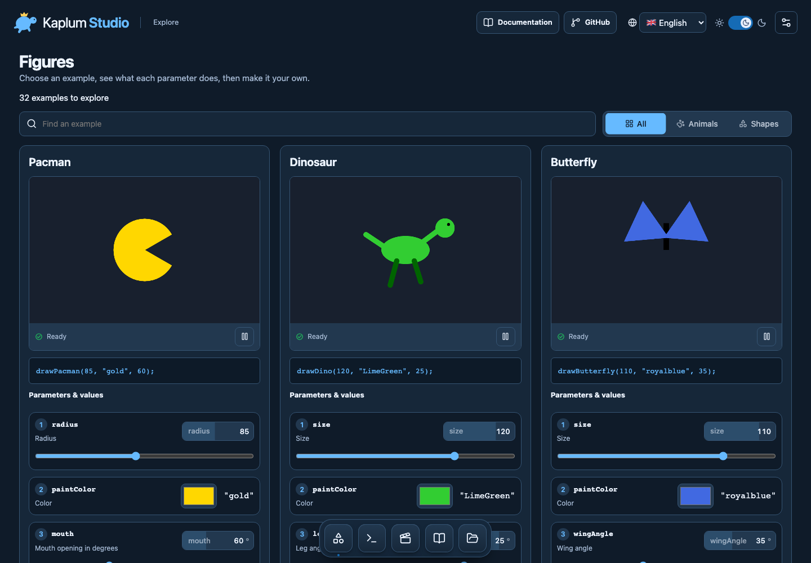
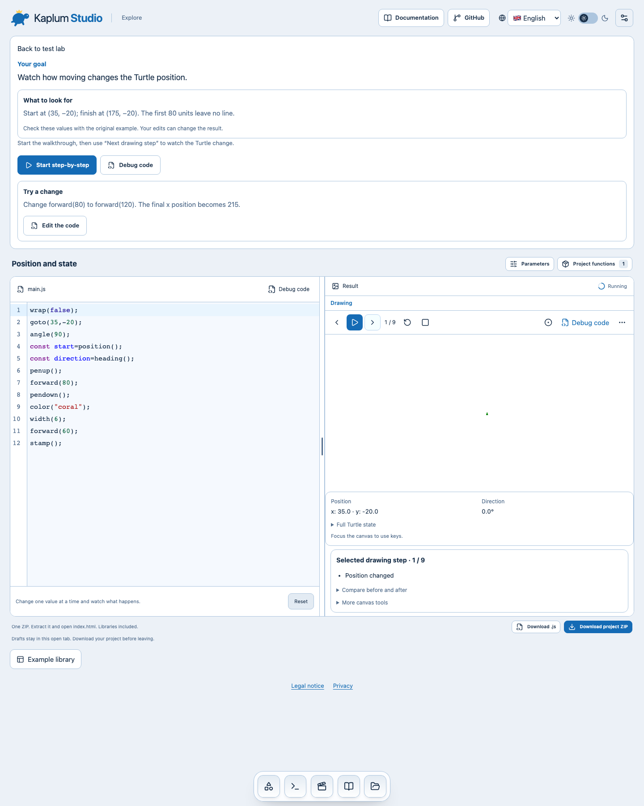

# Kaplum Studio

[](LICENSE)
[](.github/workflows/ci.yml)
[](#project-status)

[**Live Studio**](https://pengusto.github.io/kaplum-studio/) · [**Documentation**](https://pengusto.github.io/kaplum-studio/docs/) · **English** · [Deutsch](docs/readme/README.de.md)

Kaplum Studio is a visual JavaScript Turtle studio for children who are new to programming. Learners pick a drawing or animation, see its code next to the live result, understand what each parameter does, change a value and immediately see the effect.

It grew out of teaching beginner programming courses, where the hardest part was rarely the idea of a function call. It was connecting `drawDino(80, "LimeGreen", 25)` to *which number does what*.



## What it does

- **Example library.** 32 figures, 73 commands and helpers and 26 animations, each with a real preview rendered by the engine.
- **Code and result together.** A CodeMirror editor sits above the canvas, with Run, Restart and Stop next to the result. Animations start automatically, except when reduced motion is requested.
- **Parameters made visible.** Each argument in the code gets a number that matches a row in the inspector: parameter name, current value and plain-language meaning. Figure and command catalogue cards expose numeric controls, colours and boolean choices directly, updating the live preview and displayed call. Expressions remain read-only; existing Studio drafts are preserved.
- **Safe execution.** Learner code runs in a Web Worker inside a sandboxed iframe. Stop, navigation and hidden tabs terminate it, so an infinite loop cannot freeze the page.
- **Offline project export.** One ZIP contains `index.html`, the learner's exact `program.js` and the engine. Unzip it, open `index.html` and it runs without a server or internet connection.
- **Comfortable for long sessions.** Dark interface and dark canvas by default, with independent light options. The settings are kept in the browser.

## Quick start

Requires [Bun](https://bun.sh) 1.4.2 and a current Chromium or Firefox. Safari has not been tested yet.

```sh
bun install --frozen-lockfile
bun run dev
```

Open http://localhost:4173.

To build the static site and serve it locally:

```sh
bun run build      # static export in out/
bun run preview    # serves out/ on http://localhost:4173
```

`out/` is plain static files and can be served by any web server. There is no backend, account, analytics or cloud storage.

## Tests

The Playwright suite runs against the production build and checks real behaviour: the full catalogue and search, drawing and stopping animations, isolation of infinite loops, theme and canvas settings, keyboard access, the mobile layout, source-preserving parameter edits and an extracted offline ZIP that actually runs.

```sh
bun run build
bun run test
PLAYWRIGHT_BROWSER=firefox bun run test
```

First run: `bunx playwright install chromium firefox`. The suite also refreshes the screenshots in `docs/images/`. The Pages workflow calls CI once on every push to `main`: build plus both browsers. Pull requests run CI directly; deployment requires successful verification.

## How it is built

Next.js (App Router, static export), React 19, CodeMirror 6 and Bun. The Turtle engine is a maintained JavaScript library that runs inside the worker. Interface details use selected [React Bits](https://reactbits.dev) components and [Lucide](https://lucide.dev) icons. See [docs/architecture.md](docs/architecture.md) for the execution model and project layout, and [docs/teaching-api.md](docs/teaching-api.md) for the drawing commands.

## Project status

Kaplum Studio is in early development and used for teaching. Working today: the example library, the studio, inline figure and command parameter controls, dark and light modes and offline export.

The course includes eight runnable experiments with a goal, an observable baseline and a source-edit challenge. Finite drawings support recorded playback and drawing undo. Frame animations support pause/resume; timer and input programs use Run/Stop.

A bounded [source debugger prototype](docs/source-debugger.md) now pauses before code instructions, highlights the line and shows primitive variables. It supports simple variables, direct teaching calls and braced for/while/if; source-line breakpoints are available; own-function stepping is still pending ([#6](https://github.com/pengusto/kaplum-studio/issues/6)). Independent named turtles remain planned ([#7](https://github.com/pengusto/kaplum-studio/issues/7)). The optional p5.js mode is deferred. Safari, native translation review and classroom usability remain unverified.

**Languages.** Complete interface and teaching content in English, German, Japanese, Turkish and Armenian. Translations are AI-assisted; native-speaker review is still welcome. Learner code uses English JavaScript names; German aliases exist for teaching commands.

## License

Kaplum Studio's own code is released under the [MIT License](LICENSE).

Some parts come from other projects and keep their own licences:

- `engine/library.js` is a new Canvas-based Turtle core under MIT. It replaces the adapted teaching-fork core and its bundled RGB parser. The drawing helpers in `engine/functions.js` were created by Enis Uysal with Codex assistance, as confirmed by the owner, and are covered by the project MIT License. This release repository starts from the current source and does not include the previous teaching-fork engine or its Git history. Third-party licences are retained in [THIRD_PARTY_NOTICES.txt](THIRD_PARTY_NOTICES.txt).
- React Bits components in `components/react-bits/` are under MIT + Commons Clause. See [their licence](components/react-bits/LICENSE.md).
- npm dependencies are listed in `THIRD_PARTY_NOTICES.txt`.

Appearance settings offer ten coordinated Studio colour presets, saved locally. Dark/light appearance and canvas background are independent. Dock names appear on hover or keyboard focus; drawing and code syntax colours retain their meaning.

The Dock opens Figures, Basic commands and Animations directly, alongside Course and My projects. Each catalogue is searchable and uses the full content width. Figure and command overview cards offer an isolated live configurator: React Bits ScrubField, range controls, boolean choices and the browser colour picker update the actual Turtle drawing and displayed call. Open in Studio transfers a configured example only when no Studio draft exists. Existing drafts remain intact. Unsupported expression arguments are displayed rather than evaluated by the UI.

Catalogue previews execute the real Turtle examples only while at least 35% visible. Scrolling away or hiding the tab terminates their sandbox; returning restarts the example. Explicit pauses persist across catalogue navigation within the open tab. Reduced motion requires explicit playback. The Dock is a fixed overlay on desktop and mobile; scroll tails keep final controls reachable.

## GitHub Pages

The Pages workflow builds and tests the static export at `/kaplum-studio` before deploying. Local and VPS builds use the root path by default. To test the Pages mount locally:

```sh
NEXT_PUBLIC_BASE_PATH=/kaplum-studio bun run build
NEXT_PUBLIC_BASE_PATH=/kaplum-studio bunx playwright test tests/pages.spec.js
```

The interface, parameter explanations, figure descriptions and activities are available in English, German, Japanese, Turkish and Armenian. Function names and learner code remain English; changing language never translates an edited program.

Commands distinguish Turtle primitives, general drawing helpers and example figures. The workspace includes live position/direction/pen state, an optional coordinate grid and pointer-coordinate copying. Focus the canvas for `onKey`; `onClick` receives logical coordinates. Both support unsubscribing and standalone exports. See [Teaching API](docs/teaching-api.md) for the contracts.

## Try the new Turtle features

Open the [feature test lab](https://pengusto.github.io/kaplum-studio/#course): square replay, pen-up travel, removable stamps, circle paths versus static shapes, undo-clear, position queries, colour/width and edge wrapping. Each lesson explains its goal, what to look for in the original example and one change to try. **Edit code** focuses the editor without replacing your draft. Open a lesson and choose **Start step-by-step**. Play/pause, previous/next step, restart and stop sit above the canvas; the progress counter shows your place. The recording icon starts a fresh trace of edited code. The **More canvas tools** menu contains the coordinate grid, playback speed, final drawing and undo. Position and heading stay visible below the canvas; expand the state and before/after comparison when needed. **Undo drawing step** discards later drawing history; **Previous drawing step** only rewinds playback. Reset protects edited drafts, and ZIP export preserves the exact editor source.

`stamp()`, `clearStamp(id)`, `circle(radius, extent, steps)` and recorded drawing `undo()` are general Turtle capabilities. Pacman and Dino remain example helpers, with expandable views of their maintained construction source. Replay/undo support finite synchronous programs and do not rewind JavaScript variables; use normal Run for timers or input. See [teaching API](docs/teaching-api.md) for geometry, storage limits and stamp layering.



Frame animations show **Pause animation** while running and **Resume animation** while paused. Resume retains pending frames without replaying the paused time. Restart begins again; Stop terminates execution. This pause is separate from finite drawing playback, which does not step JavaScript statements or inspect variables.

To test code stepping, open a course lesson, choose **Debug code** above the canvas, then use **Next code statement**. The highlighted instruction has not run yet. Continue runs to completion unless you pause or stop. See [supported syntax and limitations](docs/source-debugger.md).

In the debugger panel, set a **Breakpoint line** to pause before the next supported checkpoint on that line. Continue can hit it again in a loop. Restart preserves it; editing code clears it.
