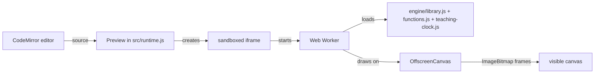

# Architecture

Kaplum Studio is a static Next.js export. Everything runs in the browser; there is no server-side code.

## Execution model

Each Run or Restart builds a fresh sandboxed iframe with a new worker, so no state leaks between runs. Stop, navigation and hidden tabs terminate the worker, which also ends infinite loops. `requestAnimationFrame` inside the worker is driven by a deterministic 60 Hz teaching clock, so animations behave the same on fast and slow machines.

The offline export (`src/exports.js`, `src/zip.js`) writes a ZIP without any library: `index.html`, the exact learner `program.js`, the engine files and `THIRD_PARTY_NOTICES.txt`. The exported page runs the program directly, without the editor's isolation.

## Project layout

| Path | Contents |
| --- | --- |
| `app/` | Next.js entry, layout and global styles (`atlas.css` is the active layout) |
| `components/` | React UI: `Studio` shell, `Gallery` library, `Workspace` editor/result/inspector, settings, parameter views |
| `components/react-bits/` | Vendored React Bits components with their licence and source hashes |
| `src/` | Framework-free logic: runtime and worker, editor setup, catalogue data, parameter parsing, export, translations |
| `engine/` | The Turtle drawing library that runs inside the worker |
| `assets/` | Preview images rendered by the real engine (light originals and dark variants) |
| `scripts/` | Build preparation and dark-preview generation |
| `tests/` | Playwright behaviour tests against the production build |
| `docs/` | API reference, glossary, decision records, screenshots and design references |

`scripts/prepare-public.js` copies the engine, worker, assets and notices into `public/` before each build. `public/` is generated and not committed.

## Parameter teaching

`src/parameters.js` parses learner code with the Lezer JavaScript parser to find a call such as `drawDino(...)` and its arguments, including nested expressions. The inspector maps each argument to the parameter at the same position in the command's signature. The Dino fields only rewrite that call when every argument is a plain literal; variables and expressions are left for the learner to edit in the code.

## Decisions

- [Solution vault is a learning gate, not access control](adr/0001-solution-vault-is-a-learning-gate.md)

Catalogue cards expose the shared `ParameterControls` directly for figures and commands. Literal parameter edits update the call, the visible-only sandbox preview and the code shown in the card. Expressions remain read-only. Opening Studio transfers the edited source only when no existing draft is present. Explicitly paused previews remain paused during parameter changes.

Studio surfaces use `StudioCard`, without pointer-following light or edge layers. Catalogue entrances use the installed Motion runtime and respect reduced motion. Category filters reuse the official React Bits RubberSegment with radio/keyboard semantics; Dock, WarmTooltip, StatusMark and ScrubField retain their focused roles.
